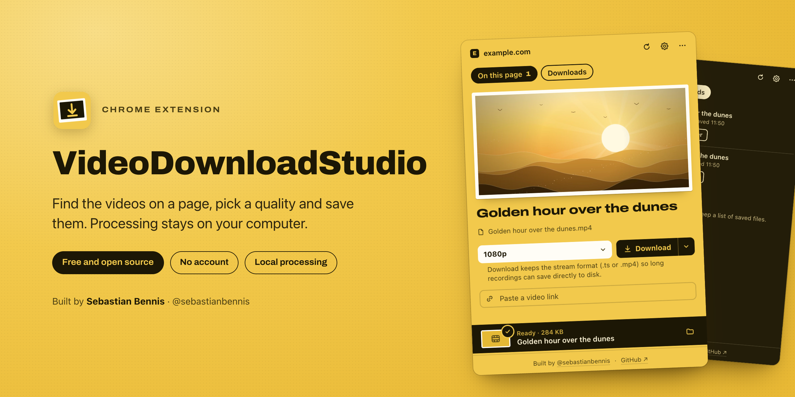
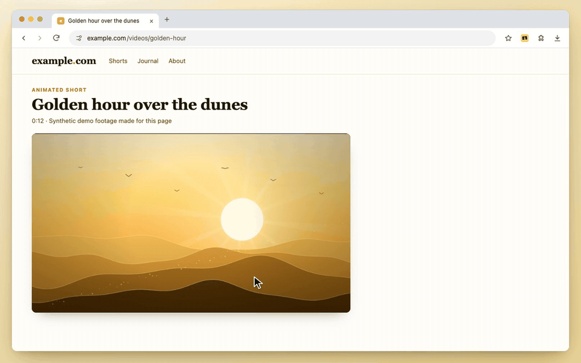
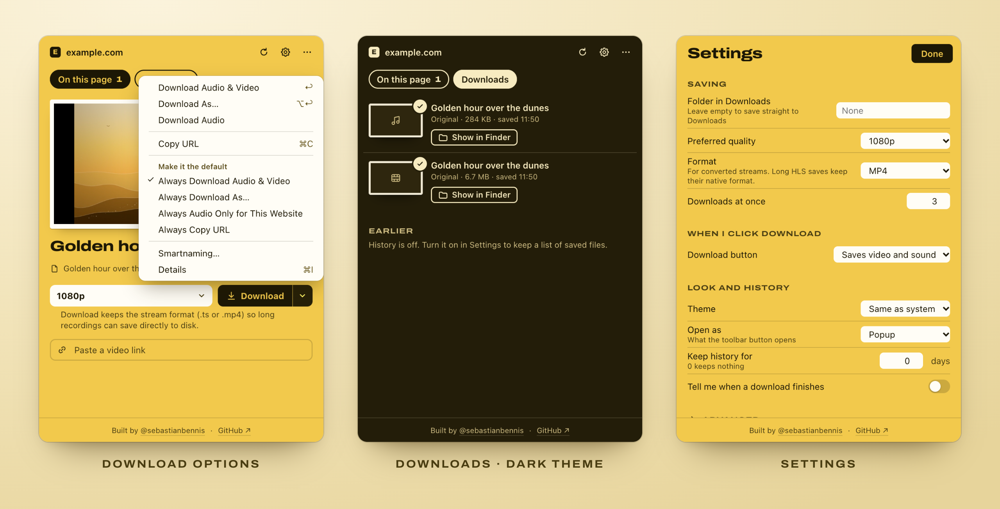

 

**Made by Sebastian Bennis** · [X @sebastianbennis](https://x.com/sebastianbennis) · [GitHub @sebastianbennis](https://github.com/sebastianbennis)

[Install](#install-in-chrome) · [Features](#features) · [Limitations](#limitations) · [Privacy](#privacy) · [License](#license)

 

VideoDownloadStudio is a free Chrome extension that finds the video and audio on the page you are watching and saves it to your computer. Open it, click **Find Videos**, pick a quality and press **Download**. Streams are fetched by your own browser and stitched, converted or turned into audio right there, using a bundled FFmpeg WebAssembly build.

There is no account, no subscription, no watermark, no analytics and no server of its own. Media comes straight from the website to your browser, never through a third-party server.

## See it in action

  

Recorded with the real extension in a clean Chromium profile, on a local demo page with synthetic footage. The browser frame is drawn; the panel, the downloads and both saved files are real.

## Features

**Find what is on the page.** One click scans the page and its network activity for direct video files and HLS or DASH streams. The main video is shown large, with any others listed below it.

**Pick the quality you want.** Every option shows its resolution with a familiar name (HD, Full HD, 4K), format, codec, frame rate, bitrate and an estimated size. Hover a video to preview its first seconds before you save.

**Video, audio, or both.** **Download** saves video with sound. The arrow beside it offers **Download As…**, **Download Audio** (MP3, extracted on your computer), Copy URL and your own defaults, including "always audio only" for a particular website. Separate audio and video tracks are merged for you.

**Record live streams.** Supported live HLS streams can be recorded and finished with **Stop and Save**, including X Spaces that are playing in the page. Long recordings are kept on disk while they record, not in memory.

**A download queue you control.** Run several downloads at once, cancel or retry any of them, and jump to the saved file with **Show in Finder** (Show in Folder on Windows and Linux).

**Tidy file names.** Titles come from what the site calls the video, cleaned of notification counts, site suffixes and hashtag runs. Smartnaming templates such as `{title}-{date}` and per-site rules let you name files your way.

**Made to fit your browser.** Open it as a toolbar popup or in Chrome's side panel, in light or dark, with keyboard shortcuts throughout. Download history is optional, stays local and is off by default.

**Built for popular sites.** Dedicated support for YouTube (experimental), Facebook, Instagram, Reddit, X, LinkedIn, TikTok, Vimeo, Twitch, Dailymotion, Threads, Bluesky, Pinterest, Tumblr, Streamable, 9GAG, Loom, Rumble, Kick, SoundCloud and Bilibili, plus ordinary web pages. Coverage depends on the page, your account and the formats each site serves, so a listed site is not a guarantee that every video downloads.

  

<b>Keyboard shortcuts</b>

 

| Shortcut | Action |
| :-- | :-- |
| <kbd>Alt</kbd> <kbd>Shift</kbd> <kbd>D</kbd> | Open VideoDownloadStudio (change it at `chrome://extensions/shortcuts`) |
| <kbd>↑</kbd> <kbd>↓</kbd> | Move between videos |
| <kbd>Return</kbd> | Download, or your chosen default action |
| <kbd>⌥ Option</kbd> / <kbd>Alt</kbd> + <kbd>Return</kbd> | Download As… |
| <kbd>Space</kbd> | Preview |
| <kbd>⌘</kbd> / <kbd>Ctrl</kbd> + <kbd>I</kbd> | Details: route, codecs and other technical data |
| <kbd>⌘</kbd> / <kbd>Ctrl</kbd> + <kbd>C</kbd> | Copy the video link |
| <kbd>⌘</kbd> / <kbd>Ctrl</kbd> + <kbd>V</kbd> | Paste a video link |
| <kbd>⌘</kbd> / <kbd>Ctrl</kbd> + <kbd>,</kbd> | Settings |
| <kbd>Esc</kbd> | Close a menu |

## Install in Chrome

VideoDownloadStudio installs as an unpacked extension. This folder is ready to load as it is, with no build tools, npm or command line needed. It is not listed on the Chrome Web Store.

1. **Download it.** Get `VideoDownloadStudio-<version>.zip` from the latest release on the [Releases](../../releases) page and unzip it. (On this page, **Code**, then **Download ZIP**, works too, as does `git clone`.)
2. **Give it a permanent home.** Move the unzipped folder somewhere you will keep it, such as your Documents folder, rather than a Downloads folder you clear out. Chrome runs the extension straight from this folder, so if you delete or move it, the extension stops working.
3. **Open Chrome's extensions page.** Go to `chrome://extensions` and switch on **Developer mode** in the top right corner.
4. **Load it.** Click **Load unpacked** and choose that folder, the one that contains `manifest.json`.
5. **Pin it.** Click the puzzle piece in Chrome's toolbar and pin VideoDownloadStudio, or press <kbd>Alt</kbd> <kbd>Shift</kbd> <kbd>D</kbd>.
6. **Save something.** Open a page with a video and start playing it, then open the extension and click **Find Videos**. Chrome asks to let the extension read that site; approve it, choose a quality and click **Download**.

Requires Google Chrome 116 or newer.

**Updating.** Updates are manual. Download the new version, replace the files in the same folder, then click the reload arrow on VideoDownloadStudio's card in `chrome://extensions`. Keeping the same folder keeps your settings, because Chrome identifies an unpacked extension by where it lives.

## Limitations

Worth knowing before you install:

- **No DRM.** Netflix, Disney+, Prime Video and other services that encrypt their streams cannot be saved. The panel says the video is protected instead of offering a download. Only save media you have the right to keep, and respect each website's terms.
- **YouTube is experimental.** Formats depend on what YouTube supplies to the page. Sustained HD through YouTube's adaptive (SABR) streams and YouTube HLS remain unresolved, and login-only or account-restricted videos are not supported.
- **Websites change.** A site update, an expired link or an account restriction can stop a download that worked yesterday.
- **Size limits.** Direct downloads and most streamed (HLS) downloads are limited to 4 GiB and your available browser storage. Conversion, merging separate audio and video, and downloads in a private window are limited to 512 MiB; previews to 128 MiB.
- **Stream formats are kept.** Streamed downloads keep the stream's own format (`.ts`, `.mp4` or `.aac`), so long recordings can be saved without a conversion step.
- **Live recordings need a working connection.** X Spaces must be playable in the page, and a network failure can leave a clearly marked partial recording.
- **No automatic updates.** You update by replacing the folder, as described above.

## Privacy

- **No backend, no tracking.** The extension has no server, analytics, advertising or account. It does not send your browsing data to the developer.
- **Local processing.** Conversion, merging and audio extraction run on your computer with the bundled WebAssembly FFmpeg.
- **You decide where it can look.** Website access is optional and requested per site when you use **Find Videos**. **Allow All Websites** is a separate, explicit choice, and you can revoke access at any time in Chrome's extension settings.
- **Normal web traffic only.** Media and page requests go to the website and its media servers, just as when you watch, and may include the cookies Chrome already holds for that site. The extension does not use Chrome's cookies API or export cookie values.
- **History is off by default.** If you turn it on, it records title, file name, size, action and time, never media URLs, and you can clear it at any time.

Full details, including every permission and what is stored, are in [PRIVACY.md](PRIVACY.md).

## License

VideoDownloadStudio is free software, licensed under the **GNU General Public License v3.0 or later**. See [LICENSE](LICENSE).

Bundled components keep their own licenses, including the FFmpeg WebAssembly core (GPL-2.0-or-later), youtubei.js and QuickJS (MIT) and the Archivo typeface (SIL Open Font License 1.1). Versions, hashes, license copies and the FFmpeg build provenance are listed in [THIRD_PARTY_NOTICES.md](THIRD_PARTY_NOTICES.md).

This repository contains the ready-to-load extension, its user documentation and its licenses. The complete source code, including build scripts, tests and the upstream FFmpeg source archives, is attached to each version on the [Releases](../../releases) page as `VideoDownloadStudio-<version>-source.zip`.

 

### Made by Sebastian Bennis

Follow on X for updates and release news, 
or find more projects on GitHub.

If VideoDownloadStudio saves you time, a star on this repository helps others find it.

